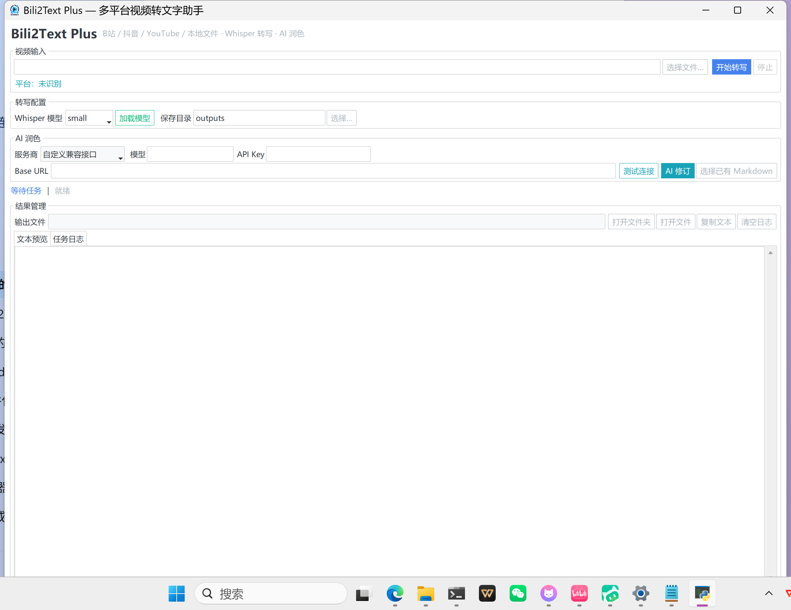

<p align="center">
  
</p>


<p align="center">
    
    
    
    
</p>

# Bili2Text Plus V2｜视频字幕优先与可溯源 AI 智能笔记

本项目是在开源 Bili2Text 基础上完成的 Python 课程作业二次开发。

原项目提供视频下载、音频提取、Whisper 语音识别和 AI 文本修订能力。

本次改造在保留原有功能的基础上，增加了老师指定的字幕优先功能，以及自主设计的可溯源 AI 学习笔记功能。

**本次作业的完整代码位于：**

`feature/subtitles-and-study-notes`

[查看 V2 项目代码](https://github.com/luhao626/bili2text-plus/tree/feature/subtitles-and-study-notes)

## 一、老师指定功能：字幕优先与 Whisper 自动兜底

传统流程需要下载视频、提取音频，再使用 Whisper 进行语音识别。

本项目新增字幕发现、选择与解析模块。

处理流程：

1. 输入视频链接。
2. 查找视频可用字幕。
3. 优先使用符合条件、来源可判断的普通字幕。
4. 没有可靠字幕时，自动回退至 Whisper。
5. 输出 Markdown 和统一时间轴数据。

支持三种文字获取方式：

* 智能模式：默认优先字幕，必要时自动使用 Whisper。
* 强制 Whisper：不使用平台字幕，直接执行语音识别。
* 仅提取字幕：不下载音频进行转写，字幕不可用时明确报错。

支持 B站指定分P，按目标分P的 CID 查找字幕，避免不同分P之间的数据混淆。

字幕来源分为人工字幕、自动字幕、未知来源和 Whisper 转写等类型。平台返回的普通字幕类别不代表已经独立核实其制作人员。

## 二、自主创新：可溯源 AI 智能课程笔记

传统 AI 视频总结可能出现知识点缺少依据、引用错误等问题。

本项目新增可溯源智能笔记功能。

AI 根据原始字幕或转写内容生成：

**1. 章节结构**

按照原始内容识别主要章节，提供章节名称及可用的时间位置。

**2. 核心知识点**

提取视频中的主要知识点，附上对应的原文证据。

系统使用统一的 `TranscriptDocument` 数据结构，记录原文、片段 ID、来源和时间信息。

AI 生成结构化知识点后，程序根据引用的片段 ID 从原始数据中回填证据，而不是直接信任 AI 自己编写的引文。

对于无法匹配的引用、部分可检测的异常信息，系统会拒绝或提示待核实。

**本功能的创新重点是提高 AI 笔记的可检查性，不保证所有知识点都已经通过完整语义事实核验。**

此外，支持导入历史 Markdown 文件生成学习笔记，不需要重新下载视频或重新进行 Whisper 识别。

没有可靠时间码时使用「原文第 N 段」定位，不编造时间戳。

## 三、V1 已有改造功能

V2 建立在 `feature/douyin-support` 分支基础上，保留此前已经实现的功能：

* B站、YouTube 和现有抖音链接解析能力。
* B站多分P参数保留与独立缓存。
* 本地音视频文件导入。
* Whisper 视频语音转文字。
* 智谱 GLM、MiniMax 等兼容接口的 AI 文本修订。
* Windows 桌面 UI。
* Markdown 结果保存、打开与预览。

抖音在线下载（2026-11 修复分支）：抖音自 2026-09 起对命令行直连收紧风控，常规 yt-dlp 访问详情接口会返回 HTTP 403。本分支通过独立的 `douyin_backend.py` 使用修复版 yt-dlp（上游 PR #17826，提交 `728fe46fbaa97d6f03efcaf9e766d4db63338b8d`，尚未正式合并）在**隔离 Python 环境**中完成抖音下载，主环境 yt-dlp 与 B站 / YouTube 下载路径不受影响。真实链路已验证：抖音公开视频链接 → 下载 → 提取音频 → Whisper 转写 → Markdown。

安装修复环境（PowerShell）需要本机已安装 **Python 3.11 或更高版本**（示例用 `py -3.11`；本机验收时实际使用的是 3.13，任何 ≥3.11 的解释器均可）：

```powershell
py -3.11 -m venv "$env:LOCALAPPDATA\Bili2TextPlus\douyin-yt-dlp-728fe46-py313"
& "$env:LOCALAPPDATA\Bili2TextPlus\douyin-yt-dlp-728fe46-py313\Scripts\python.exe" -m pip install "yt-dlp @ git+https://github.com/viking1304/yt-dlp.git@728fe46fbaa97d6f03efcaf9e766d4db63338b8d"
```

补丁提交必须固定为 `728fe46fbaa97d6f03efcaf9e766d4db63338b8d`，不要改用其他分支或最新版，否则可能重新出现 HTTP 403。

未安装修复环境时，抖音下载会给出明确的安装提示；本地文件导入功能仍可作为兜底。

详细改造记录见 [docs/DOUYIN_MODIFICATION_REPORT.md](docs/DOUYIN_MODIFICATION_REPORT.md)。

## 四、项目测试成果

最终 V2 共包含 160 项单元测试。

在 Windows 11、Python 3.10.11 的指定测试环境下，隔离虚拟环境 Scripts PATH 后，160/160 项测试通过。

原 PATH 环境下存在一项与 `yt-dlp.EXE` 大小写敏感断言有关的既有失败，该问题未在本轮作业中修改。

真实测试包括：

* YouTube 普通中文字幕直接提取：290 段，未运行 Whisper。
* B站第 33P 无字幕回退：Whisper small 完成 114 段转写。
* 旧 Markdown 生成可溯源笔记：最终 GUI 测试生成 3 个章节、9 个核心知识点，其中 2 处标记待核实。
* Windows GUI 启动、字幕模式选择、笔记生成及文件打开检查。

完整测试记录：

[docs/V2_TEST_REPORT.md](docs/V2_TEST_REPORT.md)

技术设计：

[docs/V2_DESIGN.md](docs/V2_DESIGN.md)

实际桌面 UI：

[docs/screenshots/ui-main.png](docs/screenshots/ui-main.png)

## 五、已知限制

* Whisper small 的识别准确率尚未专门优化，可能存在错字、漏字或专业术语误识别。
* B站登录态下存在人工字幕轨道时的真实下载尚未完成充分验证。
* 长视频多分块智能笔记尚未完成真实端到端测试。
* 原文引用检查不能替代完整语义事实核验。
* 使用者应当自行核对重要的学习内容。
* 抖音下载依赖独立的 Python ≥3.11 环境与固定 yt-dlp 补丁提交 `728fe46fbaa97d6f03efcaf9e766d4db63338b8d`；该补丁尚未合并进上游，平台接口变化时可能失效，换机需重新安装。
* 抖音字幕发现仍可能失败并自动回退 Whisper 转写；识别文本与近似时间码需人工核对。

---

## 原项目来源与致谢

本项目基于开源 Bili2Text 项目进行课程作业二次开发。

原项目 README 记载，项目维护账号曾由 `lanbinshijie` 迁移至 `lanbinleo`。

原项目作者及贡献者的署名与版权应予保留。本仓库继续遵守原项目 MIT 许可证要求。

以下保留原版项目的基础使用说明，并补充 V2 的实际使用方式。

## 简介 🌟
bili2text 是一个用于将视频（Bilibili、YouTube等）转换为文本的工具🛠️。这个项目通过一个简单的流程实现：下载视频、提取音频、分割音频，并使用 whisper 模型将语音转换为文本。支持AI润色功能，让转写结果更加准确和流畅。整个过程是自动的，只需输入视频链接即可。整个过程行云流水，一步到胃😂

## 功能 🚀
- 🎥**下载视频**：支持从 Bilibili 和 YouTube 下载视频，优先下载 MP4 格式，支持多P视频的下载。
- 🎵**提取音频**：从下载的视频中提取音频。
- 💬**音频分割**：将音频分割成小段，以便于进行高效的语音转文字处理。
- 🤖**语音转文字**：使用 OpenAI 的 whisper 模型将音频转换为文本，生成原始转写文档。
- ✨**AI润色**：使用 MiniMax API 对转写结果进行智能润色，修正错别字、优化断句和表达，生成更精炼的文档。

## 使用方法 📘

### 环境要求

| 依赖 | 版本 / 说明 |
| --- | --- |
| Python | 3.10 – 3.12（本项目在 3.10 验证） |
| FFmpeg | 需要 `ffmpeg` 在 PATH 中（音频提取与合并依赖它） |
| yt-dlp | 由 `requirements.txt` 安装；若下载失效，可 `pip install -U yt-dlp` |
| Whisper 模型 | 首次使用会在 `~/.cache/whisper` 自动下载（`small` 约 480MB） |

### 1. 克隆并安装

```bash
git clone https://github.com/luhao626/bili2text-plus.git
cd bili2text-plus
git switch feature/subtitles-and-study-notes
```

```bash
python -m venv .venv
# Windows
.venv\Scripts\activate
# macOS / Linux
source .venv/bin/activate

pip install -r requirements.txt
```

Windows 上如果 `ffmpeg` 不在 PATH，请从 [ffmpeg.org](https://ffmpeg.org/download.html) 下载后把 `bin` 目录加入 PATH。

### 2. 配置 AI 润色（可选）

不配置也能正常下载与转写，只生成原始 Markdown。需要润色时二选一：

**方式 A：`.env` 文件**（复制 `.env.example` 后填写）

```bash
cp .env.example .env
```

```ini
LLM_API_KEY=你的密钥
LLM_BASE_URL=https://open.bigmodel.cn/api/paas/v4
LLM_MODEL=glm-4.7-flash
```

**方式 B：界面填写**（「AI 润色」区域直接输入，不回显、不写入文件）

> 旧版本变量 `MINIMAX_APIKEY` / `MINIMAX_API_BASE` / `MINIMAX_MODEL` 仍然可用，程序会自动回退读取，因此原有配置无需迁移。`.env` 已在 `.gitignore` 中，不会被提交。

### 3. 启动

Windows 可直接双击 `Bili2Text-Plus.cmd`，或：

```bash
python window.py
```

命令行方式（无界面）：

```bash
python main.py
```

在提示时输入视频链接或 BV 号。

### 4. 界面操作流程

1. 在「视频输入」粘贴链接或抖音分享文案，右侧会自动显示识别到的平台（B站 / 抖音 / YouTube / 本地文件）与分P；
2. 平台下载被拒绝时（例如抖音返回 403），点「选择文件…」选中本地视频/音频，或直接把文件路径粘贴进输入框；
3. 在「字幕设置」选择文字获取方式（默认「智能模式」：有人工字幕就不下载不转写，没有才用 Whisper）；
4. 选择 Whisper 模型并点击「加载模型」（仅智能模式回退或强制 Whisper 时需要）；
5. 点击「开始转写」，等待完成；界面会显示当前文字来源与回退原因；
6. 需要润色时点击「AI 修订」，生成 `*_refined.md`（**永不覆盖原始文件**）；
7. 需要笔记时点击「生成智能笔记」；也可以点「选择 Markdown 生成笔记…」直接对旧文件生成；
8. 结果区可预览文本、查看完整路径、打开文件 / 文件夹、复制结果。

### 5. 运行测试

```bash
python -m unittest discover -s tests
```

V2 最终共 160 项单元测试，使用固定样本和 Mock 避免真实网络及 AI API 依赖。在指定 Windows Python 3.10.11 测试环境下，隔离虚拟环境 Scripts PATH 后 160/160 通过；原 PATH 下有一项 yt-dlp.EXE 大小写敏感断言失败，详见 V2 测试报告。

### 6. 输出文件位置

V2 任务按任务目录组织（重跑不会覆盖上一次结果），V1 的 `outputs/*.md` 原样保留：

```
outputs/
  <task_id>/                    # 时间戳_缓存键，例如 20261031165129_yt_aircAruvnKk
    transcript.md               # 原始字幕或 Whisper 转写
    transcript.json             # 可溯源时间轴（事实来源）
    study_notes.md              # 章节结构 + 核心知识点
    task_manifest.json          # 任务状态、模型、来源、文件清单（不含密钥）
  20261031133846.md             # V1 历史转写，原样保留
  20261031133846_refined.md     # V1 AI 润色版
```

媒体缓存分别在 `bilibili_video/<缓存键>/` 与 `audio/`，均已被 `.gitignore` 排除。

## 技术栈 🧰
- [Python](https://www.python.org/) 主要编程语言，负责实现程序逻辑功能
- [Whisper](https://github.com/openai/whisper) 语音转文字模型
- [yt-dlp](https://github.com/yt-dlp/yt-dlp) 视频下载工具，支持 Bilibili、抖音、YouTube 等多种平台
- [智谱 GLM](https://open.bigmodel.cn/) / [MiniMax](https://platform.minimaxi.com/) / 任意 OpenAI 兼容接口，提供 AI 润色
- [Tkiner](https://docs.python.org/3/library/tkinter.html) UI界面展示相关工具
- [TTKbootstrap](https://ttkbootstrap.readthedocs.io/en/latest/zh/) UI界面美化库

## 功能特点 ✨

### 视频下载
- ✅ 支持 Bilibili 视频下载（BV号或完整链接，`?p=` 分P精确区分）
- ✅ 抖音视频下载（修复分支）：支持解析网页链接、App 分享文案与短链；需按上文安装独立修复环境（yt-dlp PR #17826，隔离运行，不改主环境）
- ✅ 支持 YouTube 视频下载
- ✅ 支持**本地视频/音频文件**直接转写（`选择文件…` 或粘贴路径），用于平台拒绝命令行访问时的兜底
- ✅ 优先下载 MP4 格式，确保兼容性
- ✅ 自动处理多P视频，每个分P使用独立缓存，互不覆盖

### 文本转写
- ✅ 使用 Whisper 模型进行语音转文字，实际准确率受到模型、音质及专业术语影响
- ✅ 本次 V2 已验证本地 Whisper 模型转写流程
- ✅ 自动分割长音频，提高处理效率
- ✅ 生成 Markdown 格式的原始转写文档

### AI润色
- ✅ 支持智谱 GLM（含免费 `glm-4.7-flash`）、MiniMax 或任意 OpenAI 兼容接口
- ✅ 界面可切换服务商并「测试连接」，错误分类为中文提示
- ✅ 自动关闭思考模式、429 限流重试、重复尾部清理，避免空输出
- ✅ 润色文档独立保存为 `*_refined.md`，不覆盖原始文档

## 运行截图 📷



## 许可证 📄
本项目根据 MIT 许可证发布。

## 贡献 💡
如果你想为这个项目做出贡献，欢迎提交 Pull Request 或创建 Issue。

## 致谢 🙏
再此感谢Open Teens对青少年开源社区做出的贡献！[@OpenTeens](https://openteens.org)

## 使用须知 🖥️

**用户在使用 bili2text 工具时，必须遵守用户所在地区的相关版权法律和规定。请确保您有权利下载和转换的视频内容，尊重创作者的劳动成果。**
